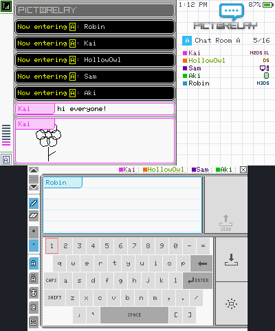
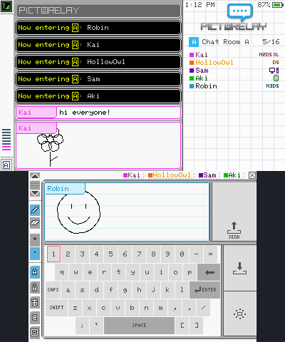

# PictoRelay 3DS

PictoChat on your Nintendo 3DS, online. Chat and draw with everyone on [pictorelay.com](https://pictorelay.com).

 

## Features

- Four chat rooms (A to D) that look and sound like the original PictoChat
- Draw and type on the bottom screen with the stylus, with the DS keyboard layouts
- Controls like PictoChat: D-pad and A to type, B to delete, X for Shift, Y for the next keyboard, L and R (hold to keep scrolling) to scroll, START to send, SELECT to copy
- See who's in each room, with badges that show which console everyone is on
- Your name, color and profile message, like on the DS
- Report button on profile cards
- Battery and clock on the top screen, and screens go dim when you're idle
- 60 FPS on every 3DS and 2DS model
- Simple 3D effect
- Updates itself: the app tells you when a new version is out and installs it

## Install

You need a 3DS with homebrew (custom firmware) and FBI. New to homebrew? See [3ds.hacks.guide](https://3ds.hacks.guide).

- **FBI:** choose Remote Install, then Scan QR Code, and scan the code on [pictorelay.com/3ds](https://pictorelay.com/3ds).
- **Releases:** download `PictoRelay.cia` from the latest release on this page.

---

The app uses 7 blocks and needs an internet connection.